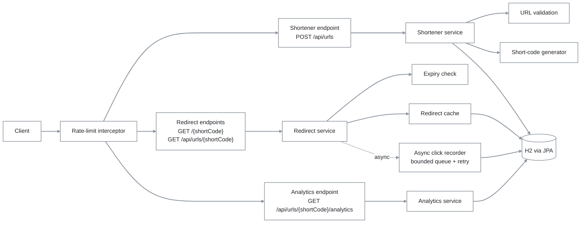
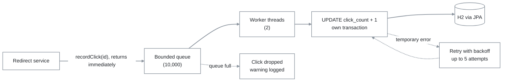

# Architecture Overview

## Scope

The service is a public URL shortener API with a small HTML test page. Its supported workflow is: create a short link (optionally with an expiration time), follow it through a short redirect, look up the original URL without redirecting, and inspect click statistics. Authentication, link ownership, custom short codes, custom domains, editing/disabling/deleting links, per-client quotas, and billing are deliberately outside the current product boundary.

The application is **one Spring Boot deployable** organized in **layers**. Inside the layers it contains three **logical services**: Shortener, Redirect, and Analytics. They share the persistence layer for this prototype but never call each other. The service classes of one logical service never import another's, and there is no network communication between them.

## Components

All packages are under com.demo.urlshortner.

| Component | Responsibility | Technology |
|---|---|---|
| REST endpoints (Shortener/Redirect/Analytics controllers) | HTTP contract, status mapping, rate-limit group assignment | Spring Web MVC |
| ShortenerService + ShortCodeGenerator | URL validation, collision-safe short-code insert with bounded retry | Spring Data JPA, SecureRandom |
| RedirectService + RedirectLookupService + RedirectTarget | Expiry check, cached lookup, hands off to click recorder | Spring Cache (@Cacheable) |
| ClickRecorder / AsyncClickRecorder + click-counting config | Non-blocking click counting: bounded queue, retry, eventual consistency | Spring @Async, Resilience4j Retry |
| AnalyticsService | Reads click stats, target URL, expiry status straight from the database | Spring Data JPA |
| UrlMapping + UrlMappingRepository | Persistence: entity mapping, unique constraint, atomic click-count update | Hibernate / JPA on H2 |
| Request/response DTOs | Request and response bodies | — |
| Platform controls (GlobalExceptionHandler, rate limiting, redirect cache config, OpenAPI, health check) | Errors → ProblemDetail, per-group rate limits, cache setup, API docs, liveness/readiness | Resilience4j RateLimiter, springdoc-openapi, Spring Boot Actuator |
| static/index.html | Manual test page | HTML + JS |

Layer dependencies: controller → service, dto; service → repository, entity, util, exception; repository → entity. Controllers never access the repository directly.

| Logical service / Swagger tag | Endpoints | Classes |
|---|---|---|
| Shortener | POST /api/urls | ShortenerController, ShortenerService, ShortCodeGenerator, ShortenUrlRequest, ShortenUrlResponse |
| Redirect | GET /{shortCode}, GET /api/urls/{shortCode} | RedirectController, RedirectService, RedirectLookupService, RedirectTarget, ResolvedUrlResponse |
| Analytics | GET /api/urls/{shortCode}/analytics | AnalyticsController, AnalyticsService, UrlAnalyticsResponse |
| Shared | — | UrlMapping, UrlMappingRepository, exception/\*, config/\* |

## Request Control Flow

Every rate-limited endpoint passes through the rate-limit interceptor first. It runs after routing and before the controller, so a rejected request (429 + Retry-After) never reaches business logic, the redirect cache, the database, or click counting. Static files, Swagger UI and /v3/api-docs are not rate limited. Errors from any step are returned as ProblemDetail by GlobalExceptionHandler (see [Error Contract](#error-contract)). Clicks are counted **asynchronously** (dotted arrow): the redirect hands the click to a bounded in-memory queue and returns immediately, and a worker thread writes it to the database. Click counts are therefore eventually consistent.

| Endpoint | Rate limit (default) | Flow | Success | Failures |
|---|---|---|---|---|
| POST /api/urls | create, 10/min | Bean Validation (url required, max 2048; optional expiresAt must be ISO-8601 with zone and in the future) → URL check (java.net.URI, http/https, host present) → generate 7-char Base62 code → saveAndFlush in its own transaction; on a uk_url_mapping_short_code violation, new code, up to 5 attempts | 201 Created, Location: shortUrl, {shortCode, shortUrl, originalUrl}; short URL built from the request's base URL; no database id | 400 Invalid request, 400 Invalid URL, 429, 500 Short code generation failed (5 collisions), 500 Internal server error (other DB errors, not retried) |
| GET /{shortCode} | redirect, 60/min | Path must match Base62 [0-9A-Za-z]+ (other paths: static resource or 404) → redirect cache, or database on a miss (caches immutable RedirectTarget: id, originalUrl, expiresAt; never the entity or clickCount; not-found is never cached) → expiry check on every request, including cache hits → click handed to the async click recorder (the redirect doesn't wait) | 302 Found, Location: originalUrl (no Cache-Control header); click_count + 1 is written shortly after by a worker thread | 404 (not cached), 410 (no click counted, row not deleted), 429 (no click counted) |
| GET /api/urls/{shortCode} | lookup, 60/min | Same cached lookup and expiry check as the redirect; no click counted | 200 {shortCode, originalUrl} | 404, 410, 429 |
| GET /api/urls/{shortCode}/analytics | analytics, 30/min | Reads the database directly, not the redirect cache; expired codes still return stats; no click counted | 200 {shortCode, originalUrl, clickCount, createdAt, expiresAt, expired, lastClickedAt}, ISO-8601 UTC; expiresAt/lastClickedAt null = never expires / never clicked | 404, 429 |

The database is where click counts are stored and read from: the Redirect service writes click_count (asynchronously, through the click recorder) and the Analytics service only reads it, so the two share the column but no code. Analytics may lag slightly behind redirects. The lookup endpoint exists for clients that can't follow a cross-origin redirect: Swagger UI's fetch() fails with a CORS error when a 302 points to a site such as Wikipedia. The HTML test page also uses it to show the original URL, and to report 404/410 on the page, before navigating to /{shortCode}. See [Short-Code Creation And Uniqueness](#short-code-creation-and-uniqueness) for collision detection.

## Runtime Data And Scaling Model

The current prototype runs as one application process. The following table states where data lives and what happens on restart.

| Concern | Current implementation | Lifetime and behavior | Replicated? |
|---|---|---|---|
| Link records | H2 **in-memory** table `url_mapping` (`jdbc:h2:mem:urlshortener`), schema from `ddl-auto=update` | Source of truth for short code, original URL, creation time, expiry and click count, **but lost when the process stops** | No; one in-process database |
| Click counts | `click_count` and `last_clicked_at` columns on the same row | Both updated atomically, in the same statement, by the async click recorder shortly after each successful redirect (eventually consistent). There are no per-click event records. | No |
| Pending clicks | Bounded in-memory queue of the `clickCountExecutor` (2 worker threads, capacity 10,000 by default) | Clicks waiting to be written. When the queue is full, new clicks are dropped and logged. A graceful shutdown writes queued clicks first (up to 10 s); a crash loses them. | No; per process |
| Redirect lookup cache | Spring Cache `redirectTargets` on `ConcurrentMapCacheManager` | Holds immutable `RedirectTarget` values. No TTL or size limit; safe because a mapping's URL and expiry never change and there's no delete API, but memory grows with the number of distinct codes redirected. Cleared on restart. | No; per process |
| Rate-limiter state | Resilience4j `RateLimiterRegistry`, one limiter per group | Permits refill every configured period. Resets on restart. | No; per process |

The schema is **not** versioned: Hibernate `ddl-auto=update` creates and alters it implicitly, which is only acceptable while the database is in memory.

Redis is not used. It is unnecessary for this local, single-instance prototype: the Spring Cache abstraction with a `ConcurrentMap` provides the redirect cache, Resilience4j keeps rate-limit state in memory, and an in-process bounded queue buffers click counting. Kafka is not used either; it is a planned future replacement for the in-memory click queue (see the roadmap doc). In a multi-instance deployment:
- **Database:** an in-memory H2 can't be shared, so a managed relational database is required.
- **Redirect cache:** can stay per instance while mappings are immutable. Adding edit or delete would require cache invalidation or a shared cache.
- **Rate limits:** in-memory limits apply per instance, so the effective limit becomes N × the configured value. That needs a shared store (e.g. Bucket4j with Redis) or enforcement at a gateway or load balancer.

## Short-Code Creation And Uniqueness

Callers can't choose short codes. Every code is generated.

`ShortCodeGenerator` creates a seven-character code using cryptographically secure random selection (`SecureRandom`) from 62 characters: digits, uppercase letters, and lowercase letters. The code is independent of the database id. It has 62^7 = 3,521,614,606,208 possible combinations.

Random generation makes collisions unlikely. The actual guarantee, including under concurrent requests, is the database unique constraint `uk_url_mapping_short_code` on `short_code`. There is no check-then-insert step. The service inserts directly and handles failures like this:

- **A violation of that specific constraint** triggers a new code, up to **5 attempts**. It's recognised by constraint name, which has been verified against H2.
- **Any other database error** is re-thrown without retry and becomes a 500.
- **After 5 collisions in a row**, the service throws `ShortCodeGenerationException`, a controlled `500` with the title "Short code generation failed".
- **Transactions:** `shorten()` is deliberately not `@Transactional`, so each attempt runs in its own transaction and a failed insert doesn't block the retry.

Shortening the same URL twice creates two distinct codes.

## Click Counting

Redirection is more important than analytics, so click counting runs **asynchronously** and analytics is **eventually consistent**.

- **Recording:** RedirectService calls `ClickRecorder.recordClick(id)` only after a successful lookup and expiry check. Unknown (404), expired (410) and rate-limited (429) requests never record a click. `AsyncClickRecorder` runs on the dedicated `clickCountExecutor` via `@Async`, so the 302 is returned without waiting.
- **Retry:** Resilience4j Retry, 5 attempts in total with exponential backoff (100 ms, 200 ms, 400 ms, 800 ms). Only temporary failures are retried — timeouts, lock contention, lost or unavailable connections. Permanent errors fail on the first attempt. Each attempt is a new transaction. After the last attempt the click is logged as an error and dropped; the user has already been redirected.
- **Known trade-offs:** counts can lag behind redirects; queued clicks are lost on a crash (a graceful shutdown writes them first, up to 10 s); new clicks are dropped when the queue is full; `click_count + 1` isn't idempotent, so a retry after an update that actually committed can, rarely, count a click twice.
- **Configuration:** `app.click-counting.async`, `.pool-size`, `.queue-capacity`, `.shutdown-await`, `.retry.max-attempts`, `.retry.initial-interval`, `.retry.multiplier`. Invalid values fail startup.

## Rate Limiting

Service-level rate limiting is the selected reliability feature for the prototype — it protects the application from excessive traffic, not per-user or per-IP quotas.

- **Mechanism:** Resilience4j `RateLimiter`, one **global, in-memory** limiter per endpoint group, local to this instance. `RateLimitInterceptor` checks the limit for methods annotated `@RateLimited(group)`. **A rate-limited redirect never increments `clickCount`.**
- **Response:** `429 Too Many Requests` (ProblemDetail) plus `Retry-After` (seconds to the next permit, rounded up, minimum 1). Every request counts toward the limit, including 400/404/410 outcomes; rejected requests don't consume a permit.
- **Not limited:** anything without `@RateLimited` — static resources, Swagger UI, `/v3/api-docs`, `/actuator/**`.
- **Groups are independent:** using up one group's limit doesn't affect another.
- **Configuration:** per-group prototype defaults via `app.rate-limit.limits.<group>.limit-for-period`, `.limit-refresh-period` and `.timeout` (default `0s`, rejects immediately). Not production capacity numbers — those should come from real traffic, load testing and SLOs.
- **Startup:** with `app.rate-limit.enabled=true` (the default), missing or invalid group configuration fails startup; with it `false`, rate limiting isn't loaded and group configuration isn't required.
- **Not yet implemented:** per-client limits, which would need a trustworthy client identity (proxy-aware IP handling or API keys); multi-instance enforcement, covered in [Runtime Data And Scaling Model](#runtime-data-and-scaling-model).

| Group | Endpoint | Prototype default |
|---|---|---|
| `create` | `POST /api/urls` | 10 / minute |
| `redirect` | `GET /{shortCode}` | 60 / minute |
| `lookup` | `GET /api/urls/{shortCode}` | 60 / minute |
| `analytics` | `GET /api/urls/{shortCode}/analytics` | 30 / minute |

## Data Model – `url_mapping`

| Column | Java field | Type | Nullable | Constraints | Notes |
|---|---|---|---|---|---|
| `id` | `id` | `BIGINT` (`Long`) | No | Primary key, identity (auto-generated) | Internal key, never exposed through the API |
| `short_code` | `shortCode` | `VARCHAR(16)` (`String`) | No | Unique (`uk_url_mapping_short_code`) | Generated 7-character Base62 code |
| `original_url` | `originalUrl` | `VARCHAR(2048)` (`String`) | No | — | The target URL (http/https) |
| `created_at` | `createdAt` | `TIMESTAMP` (`Instant`) | No | Not updatable | Set once on creation |
| `click_count` | `clickCount` | `BIGINT` (`long`) | No | — | Starts at 0, incremented asynchronously after each successful redirect |
| `expires_at` | `expiresAt` | `TIMESTAMP` (`Instant`) | Yes | — | `null` means the link never expires |
| `last_clicked_at` | `lastClickedAt` | `TIMESTAMP` (`Instant`) | Yes | — | `null` until the first successful redirect; set atomically alongside `click_count` |

## Error Contract

One `GlobalExceptionHandler` maps every failure from all three logical services to RFC 9457 `application/problem+json` (`type`, `title`, `status`, `detail`, `instance`), covering 400/404/410/429/500. No service has its own error format.

409 Conflict is deliberately not used: clients cannot choose short codes, so no client-visible conflict exists; internal short-code collisions are retried and never shown to the client.

For the exact status/title per case, see Swagger UI (`/swagger-ui.html`) or `/v3/api-docs`, which stay in sync with the code.

## Execution Approach And Controls

- **Phases:** Greenfield, Brownfield, and one ambiguous requirement, each driven by an explicit requirement list.
- **Process per phase:** inspect the owning code path → establish the test baseline → write an impact analysis → make the smallest change that satisfies the requirement → run the full regression suite.
- **Ambiguous requirement:** decomposed first; a human chose the option and its parameters before any code was written.
- **AI's role:** Claude Code sped up code reading, implementation, test writing, and code review. The engineer owned requirement interpretation, design decisions, review of every change, and final validation. AI review findings were either fixed (double-counted clicks on the test page) or explicitly deferred (the [host validation gap](#operational-boundaries)).
- **Testing:** an automated suite across four levels — unit, repository (`@DataJpaTest`, H2), API integration (`@SpringBootTest` + MockMvc), and application context — targeting the riskier behaviors: concurrent short-code collisions, async click counting, redirect caching, expiration, and rate limiting. Exact counts are in the test reports, not here.
- **Test configuration:** `src/test/resources/config/application.properties` raises all rate limits and runs click counting synchronously, so the general suite isn't throttled and can check click counts right after a redirect. `RateLimitIntegrationTest` and the async click-counting tests set their own configuration.

## Key Decisions

| Decision | Rationale | Consequence |
|---|---|---|
| One deployable, three logical services | Fast to build; clean seams to split later | Low — extraction path is documented |
| H2 in-memory, `ddl-auto=update` | Zero setup for local dev | **High** — all data lost on restart; needs a real database and migrations |
| Unique constraint + bounded retry on short-code collisions | Safe under concurrent creates, no check-then-insert race | Low — verified on H2; re-check the constraint name on another database |
| Random `SecureRandom` codes, not derived from id | Codes can't be guessed or counted | None — two shortens of the same URL giving two codes is by design |
| `302 Found` redirect | Forces every visit through the service so it's counted | Low — one DB write per redirect, already async |
| Asynchronous click counting | Redirects never wait on, or fail because of, the analytics write | Medium — counts can lag, drop on a crash or full queue, rarely double-count |
| Cache immutable `RedirectTarget`, no TTL | Cuts DB reads; cached data can't go stale | Medium — memory grows unbounded; safe only while links can't be edited |
| Soft expiry (`410 Gone`, no delete) | Expired links stay auditable | Low — no data-retention policy yet |
| Separate lookup endpoint | Works around CORS on cross-origin redirects | Low — one more endpoint to rate-limit |
| Global rate limiting, Resilience4j | Stops overload without per-client identity | **High at scale** — limit is per instance; N instances effectively allow N× the limit |
| RFC 9457 ProblemDetail everywhere, no 409 | One error shape for every client | Low — a contract choice, not a gap |

## Operational Boundaries

Spring Boot Actuator exposes `/actuator/health`, `/actuator/health/liveness` and `/actuator/health/readiness` (no other Actuator endpoints), reporting `{"status": "UP"}` once the application context is up; no per-component detail is exposed. There are no metrics or structured request logs. Only unexpected errors and short-code generation exhaustion are logged. A deployment should add request latency and error-rate metrics, rate-limit rejection counts, and cache hit ratio before production use.

Forwarded proxy headers are not configured. Behind a reverse proxy, the generated `shortUrl` would use the host that the application sees, so configure proxy trust deliberately (`server.forward-headers-strategy`) before exposing the service at an internet edge.

The service never fetches target URLs, so it doesn't make outbound requests to them. URL validation checks only the scheme (`http`/`https`) and the presence of a host. It does **not** reject internal or private addresses such as `localhost` or `10.x.x.x`. Environments that must prevent intranet navigation should enforce a DNS/egress policy or a destination allowlist outside this service. A known validation gap is still open: valid hostnames that `java.net.URI` can't parse, such as those containing underscores or non-English characters (e.g. `münchen.de`), are rejected with 400.

"Server," for a local run, means the Spring Boot process started with `./gradlew bootRun` (embedded Tomcat, port 8080). It owns the in-memory H2 database, the redirect cache, the rate-limiter state, and the pending-click queue — see [Runtime Data And Scaling Model](#runtime-data-and-scaling-model) for what each loses on restart or a crash.

## Path to Microservices

The class groups in the logical-service table are the extraction seams:

- **Shortener Service** → its own app with the Shortener classes plus copies of the shared classes. It creates mappings.
- **Redirect Service** → its own app with the Redirect classes plus copies of the shared classes. It reads mappings and writes click counts, and can scale on its own for the high-volume redirect path.
- **Analytics Service** → its own app with the Analytics classes. It only reads mappings and click counts.
- The shared H2 database becomes a shared store, or each service gets its own store kept in sync. That choice is out of scope for this prototype.

Because the services never reference each other, extraction needs no code changes to their logic. Only packaging, datasource configuration, and the in-memory cache and rate-limit state change (see [Runtime Data And Scaling Model](#runtime-data-and-scaling-model)).
