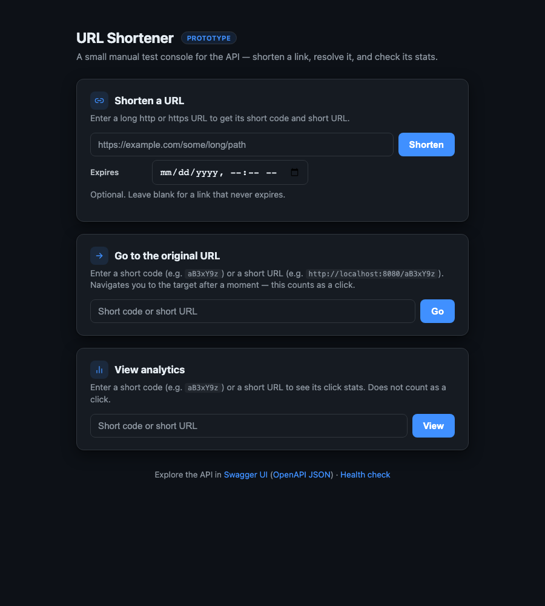
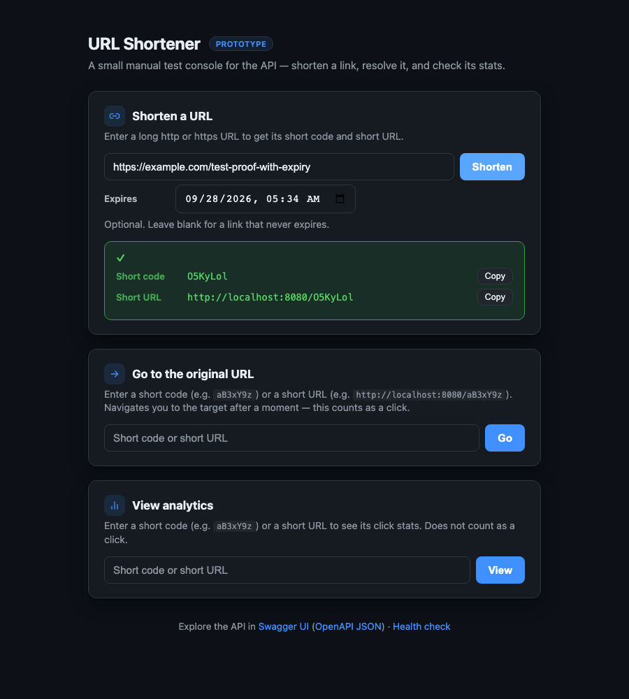
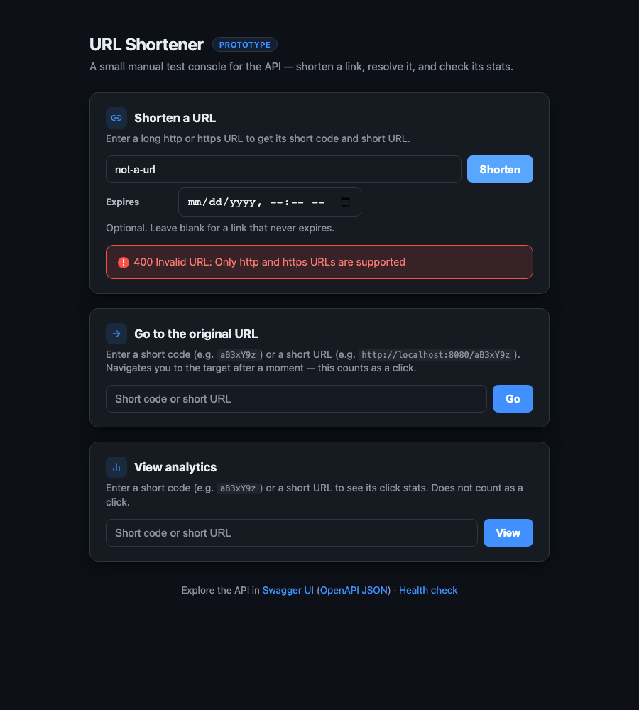
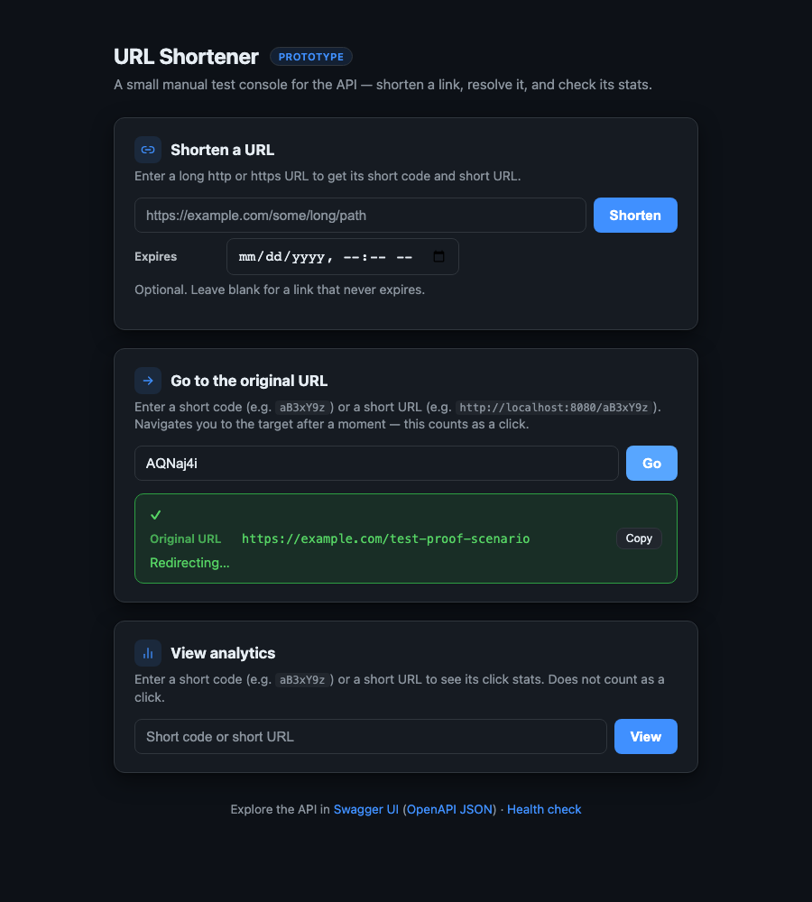
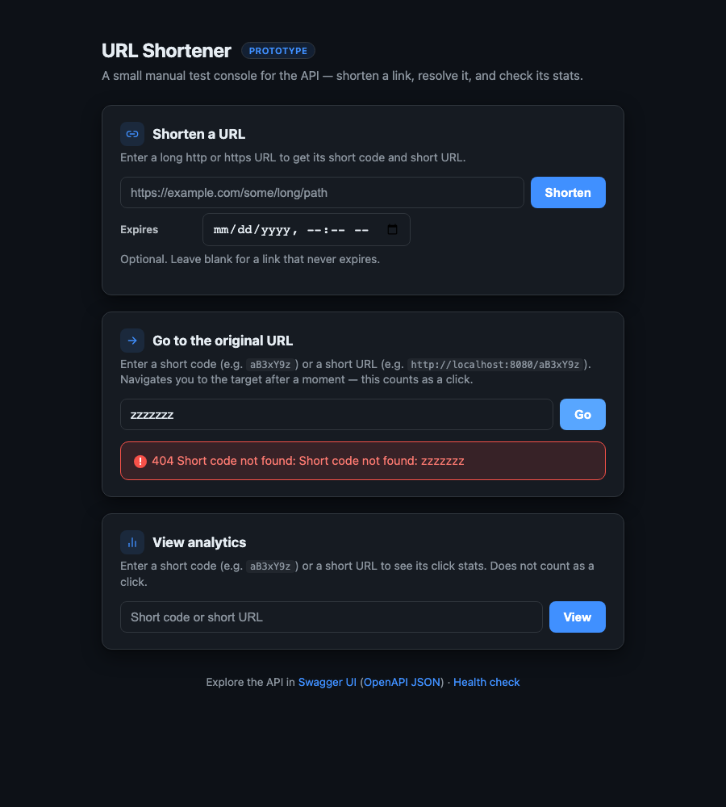
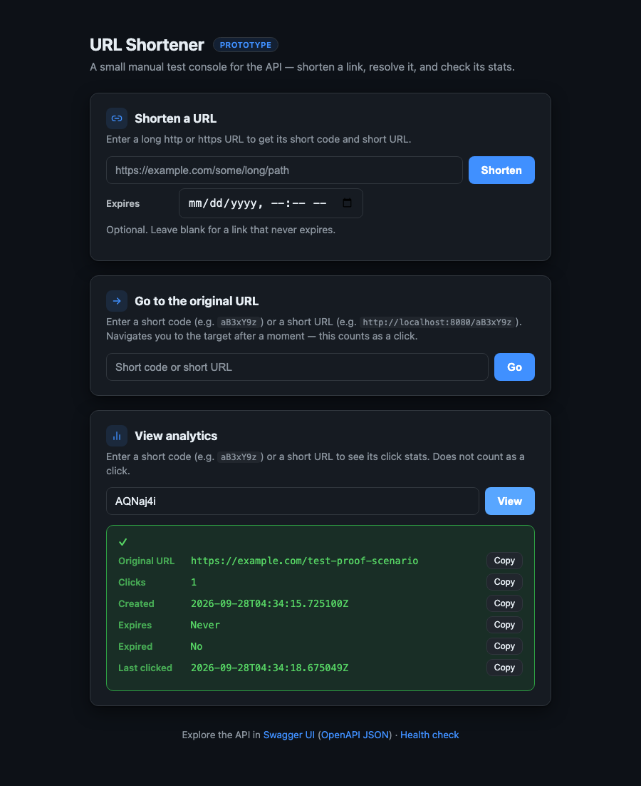
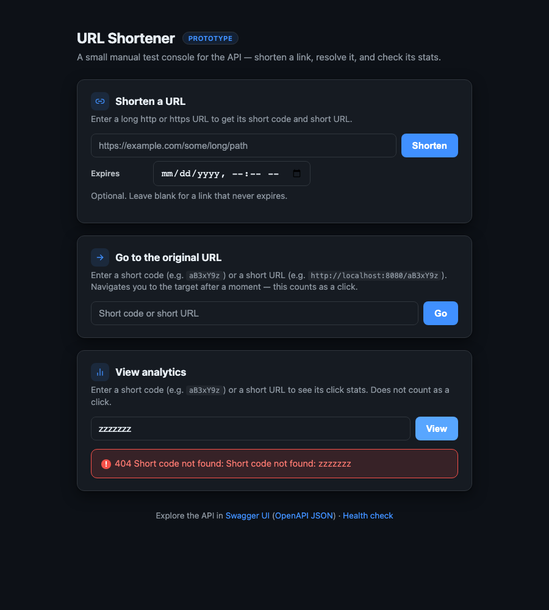

# Test Proof: Manual Test Page

This documents a real, automated run through the manual test page (`http://localhost:8080/`), driven by an actual browser (Playwright + Chromium) that filled in forms and clicked buttons exactly as a person would &mdash; not static screenshots of an untouched page. Every screenshot below shows the app's real response to a real request.

**How this was produced:** a Playwright script started a fresh instance of the app, loaded the page, and performed each scenario below in sequence, capturing a full-page screenshot after each result appeared.

## 1. Initial page

The three forms &mdash; Shorten, Redirect, Analytics &mdash; before any interaction.

## 2. Shorten a URL &mdash; success

Submitted `https://example.com/test-proof-scenario`. The app generated short code **`AQNaj4i`**.

## 3. Shorten a URL with an expiry &mdash; success

Submitted a second URL with an expiry one hour in the future. Generated a separate short code, confirming the optional expiry field works end to end.

## 4. Shorten an invalid URL &mdash; error

Submitted `not-a-url`. The app rejected it with `400 Invalid URL: Only http and https URLs are supported`, rendered in the page's error style.

## 5. Go to the original URL &mdash; success

Looked up `AQNaj4i` (the code from step 2). The page shows the resolved original URL and "Redirecting&hellip;" &mdash; then the browser was allowed to actually follow through to the real redirect, which is what counts the click (confirmed in step 7).

## 6. Go to the original URL with an unknown code &mdash; error

Looked up a code that doesn't exist (`zzzzzzz`). The app returned `404 Short code not found`.

## 7. View analytics &mdash; success

Checked analytics for `AQNaj4i` after the redirect in step 5 actually completed. **Clicks: 1** and a real **Last clicked** timestamp confirm the click was genuinely counted, not just displayed as a static example.

## 8. View analytics for an unknown code &mdash; error

Checked analytics for the same nonexistent code (`zzzzzzz`). The app returned `404 Short code not found`, same as the redirect lookup.

## What This Confirms

- All three forms (Shorten, Redirect, Analytics) work end to end against a real running instance of the app, not a mock.
- The optional expiry field on the Shorten form is accepted and produces a valid short link.
- Client-side error handling correctly surfaces the backend's actual `400`/`404` ProblemDetail responses, not a generic failure message.
- The full click-counting path is real: a redirect performed through the UI is reflected in the Analytics form's `Clicks` and `Last clicked` fields moments later, matching the asynchronous, eventually-consistent behavior documented in [ARCHITECTURE.md](ARCHITECTURE.md).
- The page's dark-mode support (`prefers-color-scheme`) renders correctly across every form and result state shown above.
